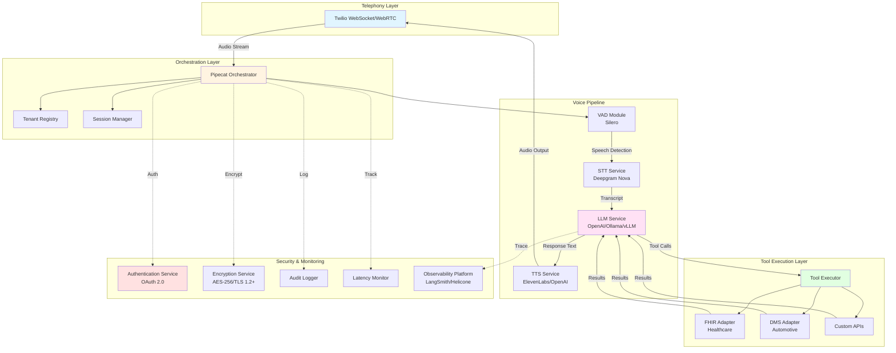

# Config-Driven Voice Agent Platform

🏆 Grand Prize Winner - SpinSci AI Hackathon 2025  
📄 Licensed under MIT License

[](LICENSE)
[](https://www.python.org/downloads/)
[](https://github.com/psf/black)
[](https://spinsci.com/)
[](LICENSE)

Production-grade, multi-tenant AI voice agent platform for enterprise call automation. Built with Pipecat orchestration, Twilio telephony, streaming STT/TTS services, and dual LLM strategies for ultra-low latency voice interactions.

Originally prototyped in 6.5 hours during the SpinSci Hackathon 2025 at T-Hub, Hyderabad (January 14-15, 2025), this platform has been significantly scaled and enhanced into a production-ready system with comprehensive testing, security features, and enterprise-grade capabilities.

## Overview

The Config-Driven Voice Agent Platform enables appointment scheduling, rescheduling, cancellations, and general call automation across different industries through configuration-driven architecture. Deploy the same codebase for healthcare clinics, automotive dealerships, or custom use cases without writing new code.

The platform addresses the enterprise telecommunications transformation from rigid IVR systems to autonomous AI agents capable of executing complex, multi-turn workflows with human-like prosody and semantic comprehension. By decoupling core conversational intelligence from domain-specific business logic, a single platform seamlessly transitions between industries simply by loading different configuration payloads.

## Hackathon Achievement

This platform won the grand prize at the SpinSci AI Hackathon 2025, competing against 10 shortlisted teams from across India. The event took place on January 14-15, 2025, at T-Hub, Hyderabad.

### From MVP to Production

The original hackathon submission was a functional MVP developed in just 6.5 hours. This repository represents a significantly enhanced and production-ready version with:

- Comprehensive test coverage including property-based testing
- Enterprise-grade security and HIPAA compliance features
- Production deployment configurations (Docker, Kubernetes, KEDA)
- Enhanced observability and monitoring capabilities
- Multiple LLM provider support (OpenAI, Ollama, vLLM)
- Extensive documentation and examples
- Scalability improvements for 1000+ concurrent calls

### The Challenge

The team initially focused on an AI-powered platform for early detection of eye diseases but quickly pivoted to align with SpinSci Technologies' mandate for AI-powered patient engagement solutions. The result was a complete AI-powered call-based appointment management system developed as an MVP in just 6.5 hours.

### Original MVP Features

The winning hackathon solution demonstrated:
- Rapid adaptation and pivot under intense pressure
- AI-driven voice calls for appointment reminders, rescheduling, and cancellations
- Intelligent rescheduling with instant booking capabilities
- EHR integration foundation for scalability
- Context-aware NLP for natural, human-like conversations
- Automation of manual processes previously handled through SMS

The MVP leveraged SpinSci's Patient Notify framework, focusing on automating patient-provider workflows through voice-enabled real-time calls using Twilio, GPT-3.5, and Ollama.

### Production Enhancements

This repository extends the original MVP with:

- Multi-tenant architecture for zero-code deployment across industries
- Dual LLM strategy with local deployment options (Ollama/vLLM)
- SMART-on-FHIR integration for Epic and Cerner EHR systems
- Automotive DMS adapter for cross-industry adaptability
- Property-based testing with Hypothesis (11 correctness properties)
- HIPAA compliance with zero-trust security architecture
- Comprehensive observability (LangSmith, Helicone, Twilio CI)
- Production deployment with auto-scaling (KEDA)
- Voice synthesis optimization with ElevenLabs Flash v2.5
- Latency optimization achieving <1000ms median response time

## Key Features

- Multi-tenant architecture with zero-code deployment for new use cases
- Ultra-low latency voice pipeline achieving median response times under 1000ms (target: 500ms)
- HIPAA-compliant security with zero-trust architecture, TLS 1.2+ encryption, and AES-256 data protection
- Dual LLM strategy supporting cloud providers (OpenAI) or local deployment (Ollama/vLLM) for data sovereignty
- Industry-specific adapters for healthcare (SMART-on-FHIR) and automotive (DMS) systems
- Production-ready deployment with Docker, Kubernetes, and KEDA-based GPU auto-scaling
- Comprehensive observability with LangSmith/Helicone integration and per-stage latency tracking
- Property-based testing for correctness validation across all components
- Empathetic voice synthesis with SSML/audio tags for emotional context
- Voice-optimized prompt engineering for natural conversational flow
- Full-duplex communication with barge-in capability for natural turn-taking
- Streaming STT/TTS processing for concurrent pipeline execution
- Handles 1000+ concurrent calls with 99.9% uptime target

## Use Cases

### Healthcare
- Appointment scheduling, rescheduling, and cancellations
- Patient reminders and follow-up calls
- Prescription refill automation
- Post-discharge check-ins
- Clinical trial recruitment
- Insurance verification calls

### Automotive
- Service appointment scheduling
- Maintenance reminders
- Emergency roadside assistance triage
- Parts availability inquiries
- Service quote generation
- Loaner vehicle coordination

### General Enterprise
- Customer service automation
- Lead qualification calls
- Survey and feedback collection
- Payment reminders
- Event registration and confirmations
- General information hotlines

The platform's configuration-driven architecture means you can deploy any of these use cases by simply creating a new tenant configuration file - no code changes required.

## Architecture

The platform uses a streaming architecture with concurrent processing stages to achieve ultra-low latency voice interactions.



### Data Flow

1. Incoming call arrives via Twilio WebSocket/WebRTC
2. Pipecat Orchestrator routes call to appropriate tenant configuration based on caller ID
3. Session Manager creates new conversation session with tenant-specific settings
4. Voice Pipeline processes audio in real-time with concurrent stages:
   - VAD (Silero) detects speech boundaries for natural turn-taking
   - STT (Deepgram Nova) transcribes audio to text with streaming interim results
   - LLM (OpenAI/Ollama/vLLM) processes transcript, classifies intent, extracts parameters
   - TTS (ElevenLabs Flash v2.5/OpenAI) converts response to audio with emotional context
5. Tool Executor handles external API calls when LLM determines tool usage needed
6. Security services encrypt data (AES-256) and authenticate API requests (OAuth 2.0)
7. Monitoring services track per-stage latency and log all operations immutably

### Latency Optimization

The platform achieves ultra-low latency through aggressive optimization at each pipeline stage:

| Pipeline Stage | Target Latency | Upper Limit | Optimization Strategy |
|----------------|----------------|-------------|----------------------|
| Media Edge/Network | 70ms | 100ms | Geographic edge server deployment |
| Speech-to-Text | 350ms | 500ms | Deepgram Nova streaming STT |
| LLM TTFT | 375ms | 750ms | Speculative decoding, quantization for local models |
| TTS TTFB | 100ms | 250ms | ElevenLabs Flash v2.5 ultra-low latency |
| Total End-to-End | ~895ms | ~1,600ms | Concurrent processing, streaming audio generation |

Key optimizations include:
- Concurrent processing: LLM begins processing as soon as STT provides interim results
- Streaming TTS: Audio generation starts before LLM completes full response
- Token streaming: TTS receives tokens as they're generated, not after completion
- Full-duplex WebSocket/WebRTC for simultaneous send/receive

Core components include:
- Tenant Registry for multi-tenant configuration management
- Session Manager for conversation state tracking
- Voice Pipeline for real-time audio processing
- Authentication and Encryption Services for security
- Audit Logger for compliance and debugging
- Latency Monitor for performance tracking

## Quick Start

### From Hackathon to Production

This platform evolved from a 6.5-hour hackathon MVP to a production-ready system. The quick start guide below demonstrates the enhanced capabilities built on top of the original concept.

### Prerequisites

- Python 3.10 or higher
- Virtual environment tool (venv, virtualenv, or conda)
- API keys for external services (Deepgram, OpenAI/Ollama, ElevenLabs, Twilio)

### Installation

1. Clone the repository:
```bash
git clone <repository-url>
cd config-driven-voice-agent
```

2. Create and activate a virtual environment:
```bash
python -m venv venv
source venv/bin/activate  # On Windows: venv\Scripts\activate
```

3. Install dependencies:
```bash
pip install -e ".[dev]"
```

4. Configure environment variables:
```bash
cp .env.example .env
# Edit .env with your API keys and configuration
```

5. Run the test suite:
```bash
pytest
```

### Quick Demo

Run the example appointment scheduling workflow:
```bash
python examples/appointment_scheduling_workflow_usage.py
```

This demonstrates the core functionality that won the hackathon: AI-powered voice calls for appointment management with natural language understanding.

### Watch the Demos

See the platform in action with demo videos in the `demo/` directory. Check out [docs/DEMOS.md](docs/DEMOS.md) for details on the available demonstrations.

## Configuration

Tenant configurations are defined in YAML or TOML files located in `config/tenants/`. Each tenant configuration specifies:

- Persona and system prompt with voice-optimized instructions
- LLM provider and model settings (OpenAI/Ollama/vLLM)
- TTS provider and voice settings (ElevenLabs/OpenAI)
- Available tools and API endpoints (FHIR/DMS/Custom)
- Knowledge bases for domain-specific information
- Operational constraints (max call duration, response brevity)

### Configuration-Driven Multi-Tenancy

The platform's core innovation is its ability to serve multiple industries without code changes. The Tenant Registry loads configurations at runtime and routes calls based on caller identification. Hot-reload capability allows configuration updates without system restart.

Example tenant configuration:

```yaml
tenant_id: healthcare_clinic_001
persona:
  name: "Sarah"
  voice_id: "elevenlabs_voice_id"
  system_prompt: "You are Sarah, a friendly medical receptionist..."
llm:
  provider: "openai"  # or "ollama", "vllm"
  model: "gpt-4"
  temperature: 0.7
  max_tokens: 150
tools:
  - name: "search_appointments"
    type: "fhir"
    endpoint: "https://fhir.epic.com/api/FHIR/R4"
    auth_type: "oauth2"
    scopes: ["patient/Appointment.read"]
constraints:
  max_call_duration: 600
  response_brevity: 3  # max sentences per utterance
```

### Healthcare Integration (SMART-on-FHIR)

For healthcare deployments, the platform integrates with Epic and Cerner EHR systems using the HL7 FHIR standard:

- OAuth 2.0 authentication with scoped access tokens
- Appointment/$find operation for searching available slots
- Appointment/$book operation for creating appointments
- Constraint checking (is-cancelable, is-reschedulable flags)
- Calendar optimization heuristics to minimize gaps and maximize provider utilization

### Automotive Integration (DMS)

For automotive deployments, the platform connects to Dealership Management Systems:

- VIN-based vehicle identification
- Service slot search and booking
- Maintenance quote retrieval
- Emergency triage for breakdown scenarios
- Parts availability checking

See `config/tenants/example_healthcare.yaml` and `config/tenants/example_automotive.yaml` for complete examples.

## Project Structure

```
config-driven-voice-agent/
├── src/voice_agent/
│   ├── core/              # Core orchestration and pipeline components
│   ├── services/          # External service integrations (STT, LLM, TTS, VAD)
│   ├── adapters/          # Industry-specific adapters (FHIR, DMS)
│   ├── security/          # Authentication and encryption services
│   ├── config/            # Configuration management and validation
│   ├── monitoring/        # Observability, logging, and latency tracking
│   ├── telephony/         # Twilio integration
│   ├── workflows/         # Conversation workflow implementations
│   └── deployment/        # Deployment and scaling controllers
├── tests/                 # Comprehensive test suite with property-based tests
├── config/tenants/        # Tenant configuration files
├── docs/                  # Documentation and guides
├── k8s/                   # Kubernetes deployment manifests
├── examples/              # Usage examples for each component
└── pyproject.toml         # Project configuration and dependencies
```

## Development

### Running Tests

Run the full test suite:
```bash
pytest
```

Run tests with coverage report:
```bash
pytest --cov=src --cov-report=html
```

Run property-based tests only:
```bash
pytest -m property
```

### Code Quality

Format code with Black:
```bash
black src tests
```

Lint code with Ruff:
```bash
ruff check src tests
```

Type checking with mypy:
```bash
mypy src
```

### Testing Strategy

The platform uses a comprehensive testing approach:

- Unit tests for individual components and functions
- Property-based tests using Hypothesis for universal correctness properties
- Integration tests for component interactions
- End-to-end tests for complete call flows
- Load tests for performance validation

All tests are located in the `tests/` directory with a structure mirroring the source code.

## Voice Synthesis and Empathy

The platform prioritizes natural, empathetic voice interactions through advanced TTS and prompt engineering:

### Text-to-Speech Providers
- ElevenLabs Flash v2.5 (primary): 75ms latency, 5000+ voices, voice cloning support
- OpenAI TTS (fallback): 200ms latency, reliable alternative
- SSML and audio tag support for emotional context: [sigh], [laughs], <excited>
- Prosody modulation based on conversation context
- Pronunciation accuracy optimized for medical and technical terminology

### Voice-Optimized Prompt Engineering
The platform uses specialized prompt architecture to ensure responses are optimized for voice-only consumption:

- No markdown formatting, tables, or bullet points in responses
- Responses limited to 3 sentences per utterance for natural pacing
- Empathetic phrasing with natural inflections
- Explicit knowledge boundary statements (no hallucinations)
- Conversational language appropriate for spoken dialogue
- Emotional context tags for appropriate tone modulation

### Conversational Workflows
Pre-built workflows for common use cases:
- Appointment scheduling with multi-turn parameter extraction
- Appointment rescheduling with constraint checking
- Appointment cancellation with confirmation
- Human handoff when workflows fail or user requests escalation
- Error handling with graceful degradation and helpful feedback

## Deployment

### Docker

Build the Docker image:
```bash
docker build -t voice-agent-platform .
```

Run with Docker Compose:
```bash
docker-compose up
```

### Kubernetes

Deploy to Kubernetes:
```bash
kubectl apply -f k8s/
```

The platform includes:
- Deployment manifests with resource limits
- Service definitions for load balancing
- ConfigMaps for environment configuration
- Secrets for sensitive credentials
- KEDA ScaledObject for GPU auto-scaling

See `docs/DEPLOYMENT.md` for detailed deployment instructions.

## Security and Compliance

The platform implements enterprise-grade security with zero-trust architecture:

- Zero-trust architecture with OAuth 2.0 authentication for all external APIs
- TLS 1.2+ for all network communication (WebSocket/WebRTC)
- AES-256-GCM encryption for data at rest
- PII/PHI tokenization for privacy protection before logging
- Immutable audit logs for compliance tracking and forensic analysis
- Business Associate Agreements (BAA) support for HIPAA compliance
- Data minimization principles: process PHI only for immediate workflow execution

### HIPAA Compliance

For healthcare deployments, the platform meets HIPAA requirements through:

- Execution of Business Associate Agreements with all third-party vendors (Twilio, OpenAI, Deepgram, ElevenLabs)
- Local LLM deployment option (Ollama/vLLM) for absolute data sovereignty
- Automated PII/PHI redaction before external API calls
- Immutable audit logs mapping every API call, database query, and state change
- Encrypted storage and transmission of all protected health information

For data sovereignty requirements or environments where BAAs are insufficient, deploy with local LLM providers (Ollama or vLLM) to ensure all data remains on-premises and never traverses the public internet.

## Performance

The platform is optimized for ultra-low latency and high concurrency:

### Latency Targets
- Median end-to-end latency: under 1000ms
- Target latency: under 500ms for optimal user experience
- Concurrent processing stages (STT, LLM, TTS) to minimize total response time
- Streaming audio generation to overlap LLM inference and TTS synthesis
- Token caching and automatic refresh to eliminate authentication delays

### Scalability
- Handles 1000+ concurrent calls
- 99.9% uptime target for production deployments
- KEDA-based auto-scaling for GPU resources (local LLM deployments)
- Dynamic resource allocation based on call volume patterns
- Cost optimization through balanced cloud API and self-hosted inference

### Latency Tracking
Per-stage metrics captured for every interaction:
- STT latency: Audio chunk to transcript
- LLM Time To First Token (TTFT): Transcript to first LLM token
- LLM Total: Complete response generation
- TTS Time To First Byte (TTFB): Text to first audio byte
- TTS Total: Complete audio generation
- End-to-end: Audio input to audio output

### Local LLM Optimization
For self-hosted deployments using Ollama or vLLM:
- Quantization (4-bit) to reduce GPU memory footprint and accelerate inference
- Speculative decoding for massive speed improvements in token generation
- PagedAttention and continuous batching (vLLM) for high-concurrency scenarios
- GPU auto-scaling to balance cost and performance

## Observability

Integrated monitoring and tracing for production deployments:

### LLM Observability
- LangSmith or Helicone for end-to-end trace captures of every user interaction
- Token consumption metrics and cost analysis
- Hallucination detection and dialogue quality monitoring
- Precise system prompt and response logging for debugging

### Telephony Intelligence
- Twilio Conversational Intelligence for sentiment analysis
- Post-call language operators for objective achievement verification
- Conversation quality metrics and compliance protocol validation

### System Monitoring
- Prometheus metrics for system health and resource utilization
- Grafana dashboards for real-time visualization
- Sentry for error tracking and alerting
- Per-session latency metrics with stage-by-stage breakdown
- Alert generation for threshold violations (latency, error rates, hallucinations)

### Audit Logging
- Immutable audit logs for all system operations
- Call initiation and termination events
- Transcript segments with PII tokenization
- LLM requests and responses
- Tool executions and results
- Authentication events and API calls
- Error conditions and latency anomalies

## Contributing

We welcome contributions from the community! This project started as a hackathon winner and has evolved into a production-ready platform. Whether you're fixing bugs, adding features, improving documentation, or sharing ideas, your contributions are valued.

### How to Contribute

1. Fork the repository
2. Create a feature branch (`git checkout -b feature/amazing-feature`)
3. Make your changes and add tests
4. Ensure all tests pass (`pytest`)
5. Commit your changes (`git commit -m 'Add amazing feature'`)
6. Push to the branch (`git push origin feature/amazing-feature`)
7. Open a Pull Request

### Development Guidelines

- Follow PEP 8 style guidelines (use `black` for formatting)
- Write tests for new features
- Update documentation as needed
- Keep commits atomic and well-described
- Ensure backward compatibility when possible

### Areas for Contribution

- Additional industry adapters (finance, retail, education)
- Enhanced voice synthesis providers
- Improved latency optimization techniques
- Additional language support for international deployments
- Enhanced observability and monitoring features
- Documentation improvements and tutorials
- Bug fixes and performance optimizations

### Community

- Report bugs and request features through GitHub Issues
- Join discussions in GitHub Discussions
- Share your use cases and implementations
- Help others in the community

## Acknowledgments

This project would not have been possible without:
- SpinSci Technologies for hosting the hackathon and providing the problem statement
- Amrita School of Artificial Intelligence, Coimbatore, Amrita Vishwa Vidyapeetham
- T-Hub, Hyderabad for providing the venue and infrastructure
- The open-source community for the amazing tools and libraries we built upon

## License

Copyright (c) 2025 SpinSci AI Hackathon 2025 Team

Licensed under the MIT License. See [LICENCE](LICENSE).
 file for details.

This software is open source and free to use, modify, and distribute under the terms of the MIT License.
